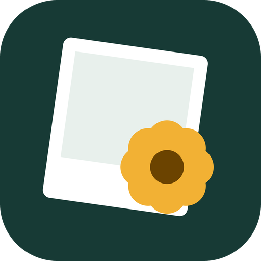
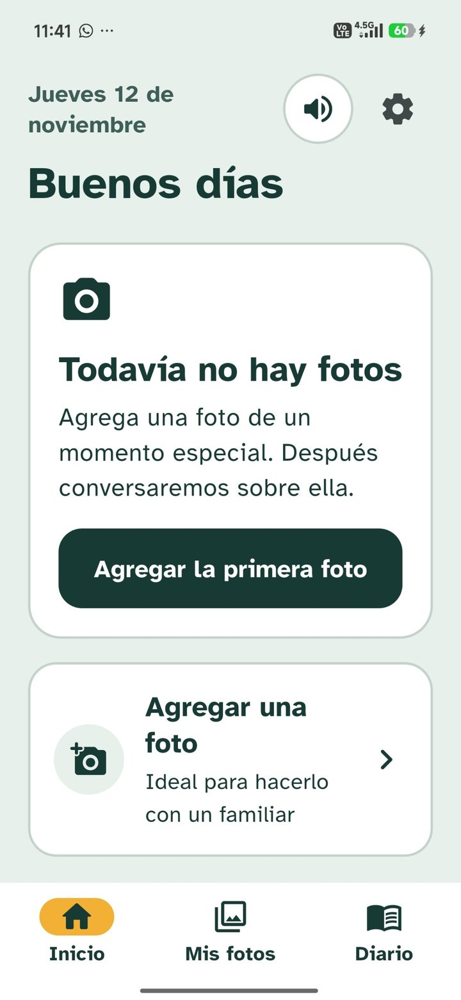
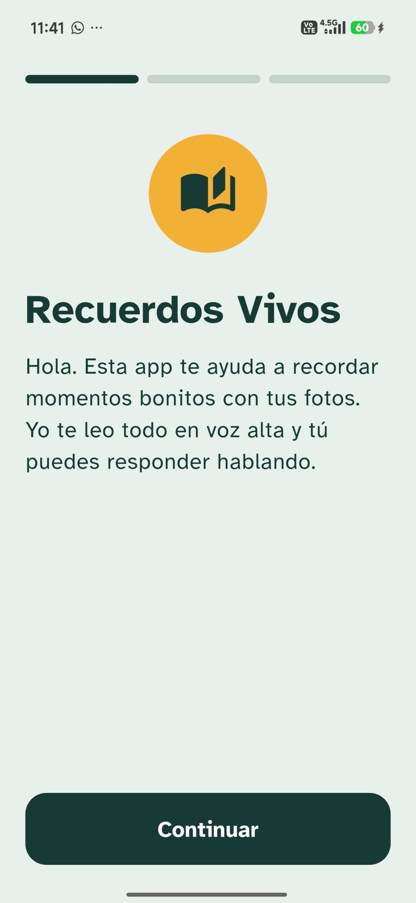
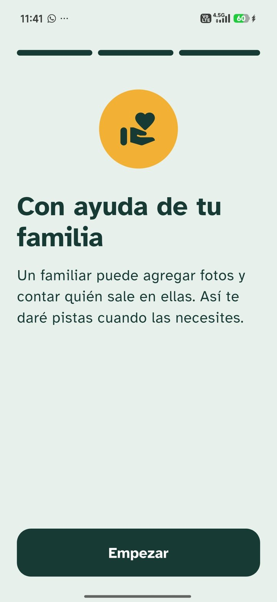
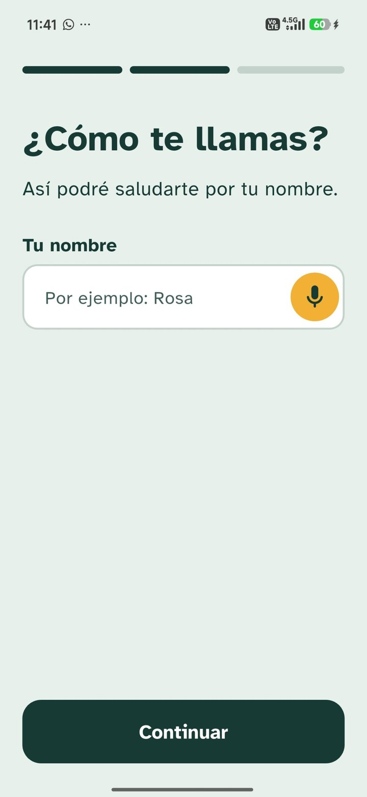
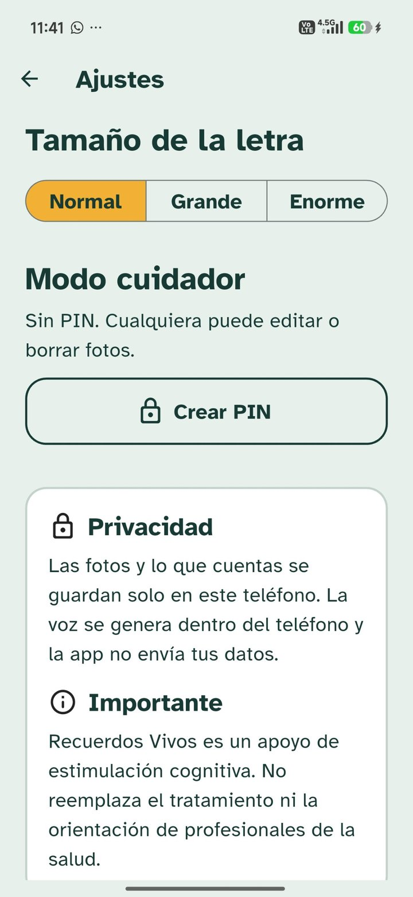
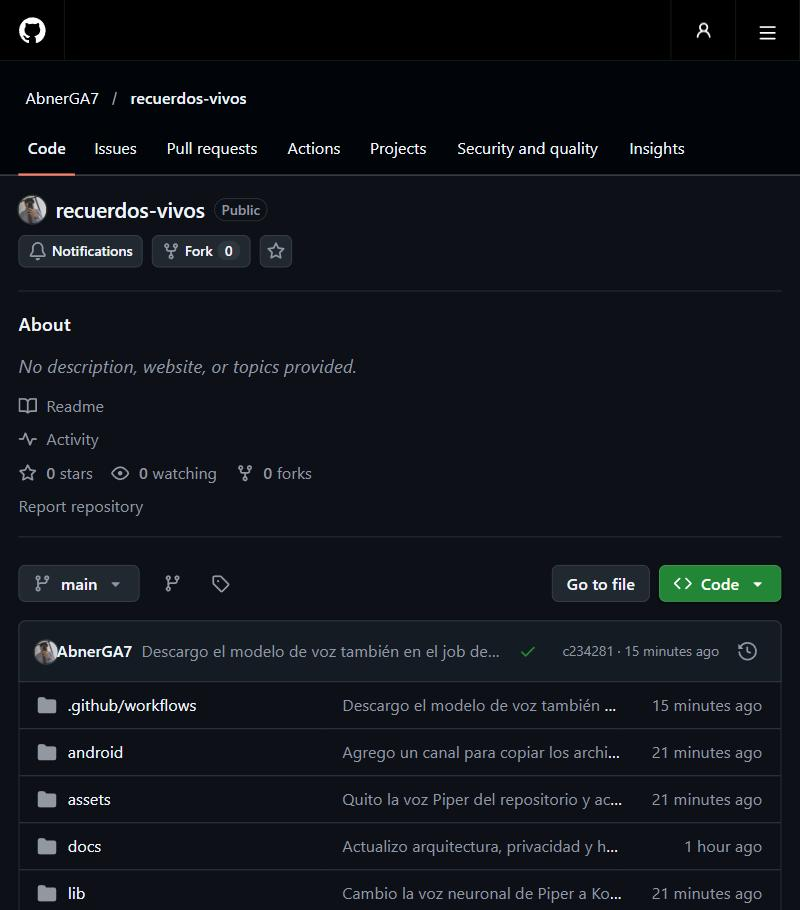
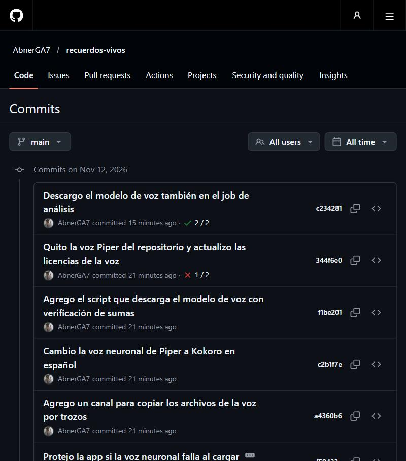

<div align="center">



# Recuerdos Vivos

**Una app Android que conversa contigo sobre tus fotos para ayudarte a recordar.**

Estimulación cognitiva basada en la terapia de reminiscencia, pensada para
personas con deterioro cognitivo o Alzheimer y para las familias que las acompañan.


[](https://github.com/AbnerGA7/recuerdos-vivos/actions/workflows/android-apk.yml)

[Qué hace](#qué-hace) · [Cómo conversa](#cómo-conversa) · [Instalar](#instalar) · [Documentación](#documentación)

</div>

> [!IMPORTANT]
> Recuerdos Vivos es un **complemento** de estimulación cognitiva. No reemplaza el
> tratamiento médico ni la orientación de profesionales de la salud.

---

## Qué hace

Un familiar sube fotos importantes y cuenta quién sale, dónde y cuándo fue.
Después, la app conversa con la persona sobre cada foto, **sin que tenga que
escribir ni tocar nada más que un botón**:

1. **Muestra la foto** en grande, con marco de álbum.
2. **Pregunta con una voz natural:** «¿Quiénes están en esta foto?».
3. **El micrófono se abre solo.** La persona responde y, cuando se queda
   callada, se cierra solo.
4. **La app contesta como en un diálogo:** celebra, anima o ayuda con pistas.
5. Al final pregunta **cómo se siente** y guarda la conversación en el **diario**.

## Cómo conversa

La app nunca dice que una respuesta está mal. Compara lo que oye con lo que
escribió el familiar y responde según el caso:

| Si la persona… | La app dice algo como |
|---|---|
| Acierta | «¡Sí! Es Carmen, tu hija. Cuéntame algo de Carmen.» |
| Acierta en parte | «¡Sí! Está Carmen. También hay alguien más. ¿Sabes quién es?» |
| Dice otra cosa | «Gracias por contármelo. Pensemos juntos. En la foto está tu hija.» |
| No recuerda | «No pasa nada, te ayudo. Su nombre empieza con la letra C.» |
| Sigue sin recordar | «No te preocupes, yo te cuento. Es Carmen, tu hija.» |

Las pistas van **en escalones**: primero el parentesco, luego la letra inicial
y al final el dato completo, siempre con cariño.

**También entiende órdenes habladas:**

| Decir | Efecto |
|---|---|
| «repite» | Repite la pregunta |
| «dame una pista» | Da la siguiente pista |
| «siguiente» | Pasa a otra pregunta |
| «más despacio» | La voz habla más lento |
| «terminar» | Cierra la conversación |

## Funciones

- 🎙️ **Conversación manos libres** por turnos, con un botón que crece con la voz.
- 🗣️ **Voz neuronal local** (Piper, español latino). Se genera dentro del teléfono.
- 💡 **Pistas en escalones** a partir de los datos del familiar; la app no inventa nada.
- 👨‍👩‍👧 **Personas con parentesco**, que se sugieren al agregar nuevas fotos.
- 📔 **Diario** de conversaciones que se puede volver a escuchar.
- 🔒 **Modo cuidador con PIN** para editar, borrar y abrir los ajustes.
- 🔤 **Subtítulos** de lo que dice la app, con la frase actual resaltada.

## Pensada para quien la usa

| Necesidad | Cómo la resolvemos |
|---|---|
| Dificultad para leer o escribir | Todo se conversa por voz; escribir es opcional |
| Baja visión | Letra Atkinson Hyperlegible, contraste AAA y tres tamaños de letra |
| Poca precisión al tocar | Botones de 68 px de alto y tarjetas completas tocables |
| Desorientación | Tres secciones fijas que nunca cambian de lugar |
| Frustración al no recordar | Nunca corrige: ayuda con pistas y celebra participar |
| Lentitud al responder | Espera, anima con «Tómate tu tiempo» y no apura |
| Cansancio | Cinco preguntas por sesión y pausa en cualquier momento |
| Privacidad | Fotos, respuestas y voz se quedan en el teléfono |

## Pantallas

| Pantalla | Para qué sirve |
|---|---|
| Bienvenida | Presenta la app en 3 pasos y pide el nombre por voz |
| Inicio | Saludo según la hora, fecha de hoy y foto sugerida |
| Mis fotos | Álbum en dos columnas con marcos de foto impresa |
| Agregar foto | Galería o cámara; personas, lugar y fecha se pueden dictar |
| Detalle | La foto con su historia, narrada en voz alta |
| Conversación | Diálogo por voz con subtítulos, pistas y progreso |
| Cierre | «¿Cómo te sientes?» y guardado en el diario |
| Diario | Conversaciones guardadas |
| Ajustes | Voz, manos libres, tamaño de letra y modo cuidador |

## Instalar

**Requisitos:** teléfono Android de 64 bits y unos 150 MB libres. La APK pesa
cerca de 118 MB porque incluye la voz neuronal.

**Opción rápida:** entra a [Actions](https://github.com/AbnerGA7/recuerdos-vivos/actions),
abre la última ejecución verde y descarga `recuerdos-vivos-apk`.

**Compilar en tu PC** (Flutter 3.47.4):

```bash
git clone https://github.com/AbnerGA7/recuerdos-vivos
cd recuerdos-vivos
flutter pub get
flutter build apk --release
flutter install --release   # con el teléfono conectado por USB
```

> [!TIP]
> En teléfonos Xiaomi activa **Instalar vía USB** en las opciones de desarrollador,
> o copia la APK al teléfono y ábrela desde el administrador de archivos.

**Primer uso:** acepta el permiso del micrófono. La voz natural tarda unos
segundos en prepararse la primera vez; mientras tanto suena la voz del teléfono.
Para que el reconocimiento de voz funcione sin internet, descarga el español
en los ajustes de idioma del teléfono.

## Tecnología

| Parte | Con qué está hecha |
|---|---|
| App | Flutter y Dart |
| Voz que habla | [Piper](https://github.com/rhasspy/piper) con [sherpa-onnx](https://github.com/k2-fsa/sherpa-onnx), en un isolate aparte |
| Voz de respaldo | Texto a voz del teléfono (`flutter_tts`) |
| Escucha | Reconocimiento de voz de Android (`speech_to_text`) |
| Datos | Archivo JSON privado en el teléfono |
| Calidad | Análisis estático, pruebas y APK en cada push con GitHub Actions |

```
lib/
├── main.dart            Punto de entrada
├── app.dart             Tema, idioma y acceso a datos y voz
├── tema/                Paleta y tema accesible
├── componentes/         Botón de voz, marco de foto, dictado, PIN…
├── datos/               Modelos, motor de diálogo y almacenamiento local
├── servicios/           Voz neuronal, voz de respaldo y escucha
├── pantallas/           Todas las pantallas
└── util/                Fechas en español
test/                    Pruebas del diálogo, los modelos y las fechas
```

## Documentación

| Documento | Contenido |
|---|---|
| [Base del proyecto](docs/00-base-del-proyecto.md) | Propósito y principios |
| [Fundamentos](docs/01-fundamentos.md) | Terapia de reminiscencia y referencias |
| [Sistema de diseño](docs/02-diseno.md) | Paleta, tipografía y reglas |
| [Arquitectura](docs/03-arquitectura.md) | Capas y dependencias |
| [Voz](docs/04-voz.md) | Voz neuronal, manos libres y órdenes |
| [Privacidad](docs/05-privacidad.md) | Qué se guarda y dónde |
| [Hoja de ruta](docs/06-hoja-de-ruta.md) | Lo hecho y lo que viene |
| [Diálogo](docs/07-dialogo.md) | Pistas en escalones |

## Avance del proyecto

En el teléfono (Xiaomi), así se ve la app:

<p>
  
  
  
  
  
</p>

El repositorio muestra el avance por commits pequeños y con CI en cada cambio: análisis, pruebas y compilación de la APK.





La voz neuronal ahora es Kokoro (español, sin internet). El modelo no va en el repositorio: se descarga con `tool/preparar_voz.sh` o `tool/preparar_voz.ps1`.

## Lo que viene

- IA local para describir la foto sin internet
- Recordatorio diario suave
- Exportar el diario en PDF para la familia o el médico
- Música de época como estímulo
- Versión para teléfonos de 32 bits

## Créditos

- Tipografía [Atkinson Hyperlegible](https://www.brailleinstitute.org/freefont/) del Braille Institute (OFL).
- Voz `es_MX-claude` de Piper (Apache-2.0) y datos de eSpeak NG (GPL-3.0).

---

<div align="center">

Hecho por **[AbnerGA7](https://github.com/AbnerGA7)** 🇵🇪

</div>
